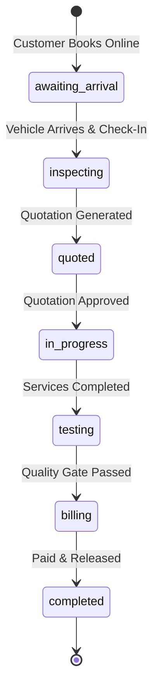

# AutoKita System Development Changelog & Documentation

This document provides a comprehensive record of all features, bug fixes, database enhancements, and architectural improvements implemented across the **AutoKita - Smart Automotive Repair Shop Management System**.

---

## Table of Contents
1. [Customer Phone Number Integration Across All Phases](#1-customer-phone-number-integration-across-all-phases)
2. [Employee Sales & Payroll Filtering](#2-employee-sales--payroll-filtering)
3. [Parts Cost, Customer Pricing & Profit Analytics](#3-parts-cost-customer-pricing--profit-analytics)
4. [Awaiting Arrival Status Workflow](#4-awaiting-arrival-status-workflow)
5. [Automatic Quotation Population from Customer Bookings](#5-automatic-quotation-population-from-customer-bookings)
6. [Mechanic Schedule Conflict Prevention Across All Job Orders](#6-mechanic-schedule-conflict-prevention-across-all-job-orders)
7. [Automatic Mechanic Scheduling Engine with 12:00 PM – 1:00 PM Lunch Break](#7-automatic-mechanic-scheduling-engine-with-1200-pm--100-pm-lunch-break)
8. [Dynamic Yellow Booking Calendar & Earliest Availability Detection](#8-dynamic-yellow-booking-calendar--earliest-availability-detection)
9. [Interactive Mechanic Schedule Feasibility Modal in Job Queue](#9-interactive-mechanic-schedule-feasibility-modal-in-job-queue)
10. [End-to-End Promised Completion Date & Time on Quotations (Admin & Customer)](#10-end-to-end-promised-completion-date--time-on-quotations-admin--customer)
11. [Calendar Swimlane Timeline Visual Lunch Break Marker](#11-calendar-swimlane-timeline-visual-lunch-break-marker)
12. [Manual Parts Delivery Estimation & Dependency-Aware Completion Scheduling](#12-manual-parts-delivery-estimation--dependency-aware-completion-scheduling)
13. [Summary of Modified & Created Files](#13-summary-of-modified--created-files)
14. [Mechanic Feasibility Modal Layout Stabilization](#14-mechanic-feasibility-modal-layout-stabilization)
15. [Cross-Job-Order Service Overlap Elimination & Timezone Normalization](#15-cross-job-order-service-overlap-elimination--timezone-normalization)
16. [Auto-Scheduler Visibility & Comprehensive Pending Rescheduling](#16-auto-scheduler-visibility--comprehensive-pending-rescheduling)
17. [Job Queue Status Alignment: Replacing "Stored in Shop" with "Approved"](#17-job-queue-status-alignment-replacing-stored-in-shop-with-approved)
18. [Visual Clarity & Layout Stabilization for Multi-Service Job Orders](#18-visual-clarity--layout-stabilization-for-multi-service-job-orders)

---

## 1. Customer Phone Number Integration Across All Phases

### Objective
Ensure customer contact phone numbers are visible across all workshop workflow phases, not just in the initial inspection report.

### Key Changes
- **Inspection Phase** ([`app/(admin)/job-orders/[id]/inspection/page.tsx`](app/(admin)/job-orders/[id]/inspection/page.tsx)):
  - Retained and standardized customer phone number presentation alongside customer name and vehicle details.
- **Quotation Phase** ([`app/(admin)/job-orders/[id]/quotation/page.tsx`](app/(admin)/job-orders/[id]/quotation/page.tsx)):
  - Added customer contact phone number to the customer profile header card.
- **Service Progress Tracking Phase** ([`app/(admin)/job-orders/[id]/progress/page.tsx`](app/(admin)/job-orders/[id]/progress/page.tsx)):
  - Added phone number display next to the customer name in the sticky top bar and header summary.
- **Road Test / Quality Gate Phase** ([`app/(admin)/job-orders/[id]/testing/page.tsx`](app/(admin)/job-orders/[id]/testing/page.tsx)):
  - Displayed customer contact info to allow test drivers or service advisors to call the customer directly if needed.
- **Billing & Invoice Settlement Phase** ([`app/(admin)/job-orders/[id]/billing/page.tsx`](app/(admin)/job-orders/[id]/billing/page.tsx)):
  - Displayed contact number for payment follow-up and receipt generation.
- **Completed / Released View** ([`app/(admin)/job-orders/[id]/completed/page.tsx`](app/(admin)/job-orders/[id]/completed/page.tsx)):
  - Formatted the customer contact number directly adjacent to the customer's full name: `Customer Name • (09XX) XXX-XXXX`.

---

## 2. Employee Sales & Payroll Filtering

### Objective
Eliminate terminated or deleted employees from displaying in the active Employee Sales and Payroll management roster.

### Key Changes
- **Backend Filter** ([`app/api/admin/sales-payroll/route.ts`](app/api/admin/sales-payroll/route.ts)):
  - Added filter condition `WHERE e.status != 'terminated'` (and `status != 'deleted'`) in the payroll and commission queries.
- **Frontend Roster** ([`app/(admin)/sales-payroll/page.tsx`](app/(admin)/sales-payroll/page.tsx)):
  - Updated mechanic and staff tables to only show active and on-leave employees.

---

## 3. Parts Cost, Customer Pricing & Profit Analytics

### Objective
Provide shop management with complete financial transparency into parts profitability by displaying:
1. Amount charged to the customer (Retail / Quotation Price).
2. Amount paid by the shop/admin (Wholesale / Supplier Purchase Cost).
3. Net profit and profit margin percentage.

### Key Changes
- **Payroll & Profit API** ([`app/api/admin/sales-payroll/route.ts`](app/api/admin/sales-payroll/route.ts)):
  - Joined `job_order_parts` and `purchase_order_it ems` / `purchases` to retrieve `unit_cost` (admin cost) and `selling_price` (customer billable).
  - Computed aggregates:
    $$\text{Parts Profit} = \sum (\text{Selling Price} - \text{Unit Cost})$$
    $$\text{Margin \%} = \frac{\text{Parts Profit}}{\text{Selling Price}} \times 100$$
- **UI Dashboard** ([`app/(admin)/sales-payroll/page.tsx`](app/(admin)/sales-payroll/page.tsx)):
  - Created KPI summary cards: **Customer Paid (Parts)**, **Admin Paid (Supplier Cost)**, **Net Parts Profit**, and **Average Margin**.
  - Added a per-job-order parts financial breakdown table highlighting revenue, direct costs, and net margins.

---

## 4. Awaiting Arrival Status Workflow

### Objective
Introduce the `awaiting_arrival` status into the job order lifecycle for booked appointments that have not yet physically arrived at the workshop.



### Key Changes
- **Type Definitions** ([`src/data/types.ts`](src/data/types.ts)):
  - Added `'awaiting_arrival'` to the `JobOrderStatus` type union.
- **Status Badge Styling** ([`src/components/StatusBadge.tsx`](src/components/StatusBadge.tsx)):
  - Added visual badge for `awaiting_arrival` with an amber/yellow badge with clock/car indicator.
- **Controller & API Integration**:
  - [`src/controllers/jobOrderController.ts`](src/controllers/jobOrderController.ts): Added status mapping and transitions.
  - [`app/api/admin/job-queue/route.ts`](app/api/admin/job-queue/route.ts): Included `awaiting_arrival` in the job queue dispatch query.
  - [`app/api/job-orders/route.ts`](app/api/job-orders/route.ts): Handled intake flow transitioning from `awaiting_arrival` to `inspecting`.
- **Job Queue UI** ([`app/(admin)/job-queue/page.tsx`](app/(admin)/job-queue/page.tsx)):
  - Added an "Awaiting Arrival" tab / quick filter so dispatchers can check in vehicles as soon as they pull into the shop bay.

---

## 5. Automatic Quotation Population from Customer Bookings

### Objective
When a customer books services online, automatically copy all chosen catalog services and packages into `job_order_services` and populate them in the Quotation phase so service advisors do not have to manually re-enter them.

### Key Changes
- **Sync Module** ([`src/lib/syncBookedServices.ts`](src/lib/syncBookedServices.ts)):
  - Created a synchronization engine that extracts requested service names, custom requests, and package IDs from `customer_bookings`.
  - Matches requested services against the master `services` catalog, populating estimated labor hours, prices, and descriptions.
- **Booking Creation Hook** ([`app/api/customer/booking/route.ts`](app/api/customer/booking/route.ts)):
  - Automatically triggers synchronization when a booking is converted into a job order.
- **Quotation Endpoint Hook** ([`app/api/job-orders/[id]/quotation/route.ts`](app/api/job-orders/[id]/quotation/route.ts)):
  - Checks if the quotation contains catalog entries; if empty, automatically pulls in all services specified in the original booking.

---

## 6. Mechanic Schedule Conflict Prevention Across All Job Orders

### Objective
1. **Mutual Exclusion**: Prohibit any mechanic from having overlapping scheduled services across **all** job orders.
2. **Buffer Policy**: Enforce a mandatory minimum **15-minute buffer** between consecutive tasks for the same mechanic.
3. **Dispatch Timeline Accuracy**: Eliminate fake `12:30 AM` phantom scheduled bars caused by database date fallbacks.

### Root Causes Identified
1. **Fallback to Midnight Date**: In `app/api/admin/schedule/route.ts`, when tasks had `scheduled_date IS NULL`, the query fell back to `jo.jo_date::timestamp` (`00:00:00` / `12:30 AM` Manila). Unscheduled services from intake and inspection were plotted at midnight, stacking on top of each other.
2. **Job Order Services Union**: The route unioned unscheduled catalog services from `job_order_services` at `12:30 AM`.
3. **Mechanic Assignment Scope**: Schedule conflict queries checked `spt.mechanic_id = $id`, missing tasks where `spt.mechanic_id` was `NULL` but assigned via `job_orders.assigned_mechanic_id`.
4. **In-Progress Tasks Ignored**: Queries only checked `spt.scheduled_date IS NOT NULL`, ignoring started tasks where `spt.started_at` was active.

### Implementation Details

#### A. Backend Validation ([`app/api/job-orders/[id]/progress/schedule/route.ts`](app/api/job-orders/[id]/progress/schedule/route.ts))
- Resolves effective mechanic: checks `mechanicId` parameter or falls back to existing `spt.mechanic_id` or `jo.assigned_mechanic_id`.
- Queries all active tasks across the database:
  ```sql
  SELECT spt.id, spt.task_title, spt.job_order_id,
         COALESCE(spt.scheduled_date, spt.started_at) AS scheduled_date,
         COALESCE(spt.mechanic_id, jo.assigned_mechanic_id) AS mechanic_id,
         COALESCE(
           COALESCE(spt.scheduled_date, spt.started_at) + (jos.estimated_hours * INTERVAL '1 hour'),
           COALESCE(spt.scheduled_date, spt.started_at) + INTERVAL '1.5 hours'
         ) AS estimated_finish,
         COALESCE(jos.estimated_hours, 1.5)::numeric AS estimated_hours,
         COALESCE(e.full_name, jo_m.full_name, 'The assigned mechanic') AS mechanic_name
  FROM service_progress_tasks spt
  JOIN job_orders jo ON jo.id = spt.job_order_id
  LEFT JOIN employees e ON e.id = spt.mechanic_id
  LEFT JOIN employees jo_m ON jo_m.id = jo.assigned_mechanic_id
  LEFT JOIN LATERAL ( ... ) jos ON true
  WHERE spt.id != $1::int
    AND spt.task_status NOT IN ('completed', 'cancelled')
    AND COALESCE(spt.scheduled_date, spt.started_at) IS NOT NULL
    AND (
      ($2::int IS NOT NULL AND COALESCE(spt.mechanic_id, jo.assigned_mechanic_id) = $2::int)
      OR spt.job_order_id = $3::int
    )
  ```
- Rejects any overlap or buffer violation with HTTP 409:
  ```json
  {
    "success": false,
    "code": "SCHEDULE_CONFLICT",
    "message": "Scheduling conflict: Mike Wrench is already scheduled for \"Brake Service & Cleaning\" on Job Order #JO-2066 (8:00 AM – 9:15 AM). Overlapping services from the same mechanic are not allowed across all job orders (minimum 15-minute buffer required)."
  }
  ```

#### B. Auto-Scheduling Engine ([`app/api/job-orders/[id]/progress/suggest-schedule/route.ts`](app/api/job-orders/[id]/progress/suggest-schedule/route.ts))
- Updated `mechanicBusyResult` to aggregate all scheduled and started tasks across all job orders using `COALESCE(spt.mechanic_id, jo.assigned_mechanic_id)`.
- Applied the same rule to `carBusyResult` using `COALESCE(spt.scheduled_date, spt.started_at)`.
- Guarantees `suggestSchedule()` in `lib/autoSchedule.ts` will never propose overlapping time slots for the same mechanic.

#### C. Timeline Query ([`app/api/admin/schedule/route.ts`](app/api/admin/schedule/route.ts))
- Removed the fallback to `jo.jo_date::timestamp` and `jo.date_arrived`.
- Removed the union of unscheduled intake `job_order_services`.
- Only genuinely scheduled or actively in-progress/completed services are displayed on the Dispatch Timeline.

#### D. Database Conflict Clean-Up
- Rescheduled conflicting Task 2749 (Battery Testing on Mike Wrench) from `08:00 AM` to `09:30 AM` (following Task 2747 finishing at `09:15 AM` + 15 min buffer).
- Verified zero remaining schedule conflicts across all mechanics.

---

## 7. Automatic Mechanic Scheduling Engine with 12:00 PM – 1:00 PM Lunch Break

### Objective
Ensure that upon ticket acceptance and mechanic assignment, all booked services are automatically sequenced into the assigned mechanic's schedule with strict respect for the mandatory **12:00 PM – 1:00 PM daily lunch break** and active shop operating hours (8:00 AM – 5:00 PM, Monday – Saturday).

### Rules & Architectural Implementation
1. **Lunch Window Pause**:
   - Working hours are split into Morning (`08:00 – 12:00`, 4 hours) and Afternoon (`13:00 – 17:00`, 4 hours) chunks (8 productive hours/day).
   - Any job starting or landing between `12:00 PM – 1:00 PM` automatically snaps to `1:00 PM`.
   - If a multi-hour task crosses 12:00 PM (e.g., a 2-hour service starting at 11:00 AM), 1 hour executes in the morning, work pauses during lunch, and resumes at 1:00 PM to finish at 2:00 PM.
2. **Buffer & Conflict Prevention**:
   - Every scheduled service maintains a mandatory **15-minute cool-down / bay turnaround buffer** before the next service can begin.
3. **Task & Job Order Synchronization**:
   - Auto-generates `service_progress_tasks` for the assigned mechanic when the ticket is approved in the job queue.
   - Calculates the exact completion timestamp of the final service and writes it directly to `job_orders.date_promised`.

---

## 8. Dynamic Yellow Booking Calendar & Earliest Availability Detection

### Objective
Provide customers and dispatchers with clear visual indicators when shop capacity is stressed, and calculate dynamic completion estimates starting from when a mechanic is actually available to handle the vehicle from start to finish.

### Key Changes
- **Yellow / Busy Status Definition** (`'busy'`):
  - A calendar date is classified as **Yellow (`🟡 Mechanics busy`)** when all active mechanics have existing scheduled job orders that consume the day's available capacity, but the shop's global intake ceiling has not yet been hit.
- **Dynamic Start-to-Finish Calculation**:
  - Instead of assuming an 8:00 AM start, the booking wizard and scheduling engine identify the earliest open slot across mechanics on that date or roll over to the subsequent working day.
  - On yellow days, the booking completion prompt displays:
    `"⚠️ Mechanics are busy on this date. Services will commence at [Earliest Available Time] once a technician is free."`
- **Visit Date Picker Legend**:
  - Added visual legend marker: `🟡 Mechanics busy (Starts later)` alongside `🟢 Open` and `🔴 Full`.

---

## 9. Interactive Mechanic Schedule Feasibility Modal in Job Queue

### Objective
Replace the plain `<select>` mechanic dropdown in the Dispatch Job Queue (`/job-queue`) with an interactive, rich feasibility assessment modal that transparently shows whether an assigned mechanic can accommodate a ticket without schedule overlap.

### Modal Features & UX
- **Live Feasibility & Overlap Detection**:
  - Evaluates the mechanic's current commitments across all job orders for the selected date.
  - Simulates step-by-step start, finish, and 12–1 PM lunch pauses for each booked service.
- **Visual Overlap & Conflict Indicators**:
  - Displays green `Available` or red `Conflict / Busy` badges.
  - Pinpoints specific conflict reasons (e.g., *"Overlaps with Brake Pad Replacement (JO-12) ending at 11:30 AM"*).
- **"All Mechanics Busy" Global Banner**:
  - If every shop mechanic is booked, an amber alert banner displays:
    `"All mechanics are currently occupied. Earliest start-to-finish slot available at [Date & Time] with [Mechanic Name]."`
  - Provides a 1-click **"Apply Recommended Slot"** button.
- **Deleted & Terminated Mechanic Filtering**:
  - Excludes former/deleted staff (`status != 'terminated'`) from the feasibility evaluation, assignment rosters, and schedule queries, ensuring only currently employed mechanics (`active` or `on_leave`) are shown. Also improved assignment error messaging if a terminated employee is referenced.

---

## 10. End-to-End Promised Completion Date & Time on Quotations (Admin & Customer)

### Objective
Ensure that both the Admin and Customer quotation views reflect the exact, authoritative date and time the vehicle will be finished based on the assigned mechanic's schedule and shop working hours.

### Key Changes
- **Admin Quotation Page** ([`app/(admin)/job-orders/[id]/quotation/page.tsx`](app/(admin)/job-orders/[id]/quotation/page.tsx)):
  - Added `Assigned Mechanic` and `Estimated Ready Date & Time` to the top vehicle summary bar.
  - Added a dedicated **Estimated Ready Schedule Card** in the right sidebar with clear notice of the 12–1 PM lunch pause.
- **Customer Quotation Tracking Page** ([`app/(customer)/dashboard/tracking/quotation/page.tsx`](app/(customer)/dashboard/tracking/quotation/page.tsx)):
  - Added `Assigned Mechanic` and `Estimated Finish` to the customer's vehicle info card.
  - Rendered a highlighted **⏱️ Estimated Ready Date & Time** card in the quotation summary sidebar, reassuring the customer of their exact completion window.
- **APIs Updated**:
  - [`app/api/job-orders/[id]/quotation/route.ts`](app/api/job-orders/[id]/quotation/route.ts): Joined `employees` to return `assigned_mechanic_name` and `date_promised`.
  - [`app/api/tracking/quotation/route.ts`](app/api/tracking/quotation/route.ts): Extended customer tracking payload with `assigned_mechanic_name` and `date_promised`.

---

## 11. Calendar Swimlane Timeline Visual Lunch Break Marker

### Objective
Make the 12:00 PM – 1:00 PM mandatory lunch break immediately obvious on the workshop dispatch timeline so service advisors and shop managers never schedule over lunch.

### Key Changes
- **Swimlane Grid Lunch Column** ([`src/components/mechanics/MechanicCalendar.tsx`](src/components/mechanics/MechanicCalendar.tsx)):
  - Added a vertical shaded column across all mechanic swimlanes between 12:00 PM and 1:00 PM with an amber tint (`bg-amber-500/[0.04]`).
  - Added a floating `🍽️ Lunch Break` pill pinned to the sticky timeline ruler.
  - Highlighted the `12 PM` hour column in the sticky ruler header with `🍽️ Lunch`.

## 12. Manual Parts Delivery Estimation & Dependency-Aware Completion Scheduling

### Objective
Ensure that job order completion estimations (`date_promised`) accurately account for parts procurement lead times rather than assuming all services can begin immediately. When parts are marked **`To Order`**, the admin can manually specify an **Estimated Arrival Date**, shifting the earliest start time of dependent services and providing customers with transparent, reliable pickup times.

### Architectural Rules & Implementation
1. **Manual Arrival Date Specification**:
   - In the **Add / Edit Part Modal** ([`app/(admin)/job-orders/[id]/quotation/page.tsx`](app/(admin)/job-orders/[id]/quotation/page.tsx)), selecting **`To Order`** reveals an **Estimated Arrival Date** picker (`<input type="date">`).
   - If **`In Stock`** is selected, the date field is hidden (work can begin immediately).
   - Stored in database table `job_order_parts.estimated_delivery_date`.
2. **Work Sequencing (In-Stock First, Parts-Dependent Last)**:
   - All services that do NOT require external parts (or whose parts are in-stock) are scheduled **first**, starting immediately from vehicle drop-off / intake.
   - Mechanics do not sit idle waiting for parts before starting work; they complete fluid flushes, diagnostics, cleanings, and other in-stock services right away.
   - Services that require ordered parts are scheduled **last** (after the ready services, starting at `Math.max(cursorAfterReadyServices, partArrivalDate)`).
   - If ready services finish before parts arrive, the car waits for the parts shipment, and the remaining service begins as soon as the parts arrive.
   - The final completion timestamp (`date_promised`) is the exact finish time of the final service.
3. **Visual Transparency Across Admin & Customer Interfaces**:
   - **Quotation Parts Table**: Displays a `To Order • Est. [Date]` badge on rows with pending supplier deliveries.
   - **Quotation Vehicle Header**: Displays the dynamic `Estimated Ready: [Date & Time]` directly alongside the assigned mechanic.
   - **Customer Quotation & Tracking** ([`app/(customer)/dashboard/tracking/quotation/page.tsx`](app/(customer)/dashboard/tracking/quotation/page.tsx)): Displays parts arrival badges and an informative note indicating that completion time includes supplier procurement lead time.

---

## 13. Summary of Modified & Created Files

| File | Type | Description |
| :--- | :--- | :--- |
| `job_order_parts` table | Schema | Added `estimated_delivery_date DATE NULL` column |
| [`app/api/job-orders/[id]/quotation/route.ts`](app/api/job-orders/[id]/quotation/route.ts) | Modified | Persisted `estimated_delivery_date` and dynamically recalculated `date_promised` taking into account parts lead time |
| [`app/(admin)/job-orders/[id]/quotation/page.tsx`](app/(admin)/job-orders/[id]/quotation/page.tsx) | Modified | Added manual estimated arrival date picker to Part Modal, parts table badge, and header estimated ready time |
| [`app/(customer)/dashboard/tracking/quotation/page.tsx`](app/(customer)/dashboard/tracking/quotation/page.tsx) | Modified | Rendered estimated arrival badges in parts list and updated procurement notes in schedule card |
| [`src/controllers/quotationController.ts`](src/controllers/quotationController.ts) | Modified | Mapped `estimated_delivery_date` in `toQuotationData` |
| [`src/data/types.ts`](src/data/types.ts) | Modified | Added `estimated_delivery_date` to `QuotationPart` interface; added `awaiting_arrival` & `datePromised` |
| [`src/components/StatusBadge.tsx`](src/components/StatusBadge.tsx) | Modified | Added styling for `awaiting_arrival` status badge |
| [`src/controllers/jobOrderController.ts`](src/controllers/jobOrderController.ts) | Modified | Handled `awaiting_arrival` status transitions & added `datePromised` mapping |
| [`src/controllers/quotationController.ts`](src/controllers/quotationController.ts) | Modified | Added `datePromised` & `assignedMechanicName` to quotation data mapping |
| [`src/data/shopPolicy.ts`](src/data/shopPolicy.ts) | Modified | Defined `SHOP_LUNCH_START_HOUR = 12` and `SHOP_LUNCH_END_HOUR = 13` |
| [`src/lib/autoSchedule.ts`](src/lib/autoSchedule.ts) | Modified | Enforced 12–1 PM lunch break pauses, daily capacity adjustment, and lunch hour snapping |
| [`src/lib/visitSlots.ts`](src/lib/visitSlots.ts) | Modified | Extended `dayStatus` to support `'busy'` status alongside `'open'` and `'full'` |
| [`src/lib/bookingSlots.ts`](src/lib/bookingSlots.ts) | Modified | Calculated mechanic workload to detect busy dates & earliest availability |
| [`src/components/VisitDatePicker.tsx`](src/components/VisitDatePicker.tsx) | Modified | Added yellow styling for busy dates & updated legend |
| [`src/components/dashboard/BookingPage.tsx`](src/components/dashboard/BookingPage.tsx) | Modified | Dynamic completion estimate starting from mechanic availability on yellow days |
| [`app/api/admin/job-queue/availability/route.ts`](app/api/admin/job-queue/availability/route.ts) | **Created** | Evaluates mechanic availability, step-by-step lunch pauses, and earliest start-to-finish slot |
| [`src/components/admin/MechanicScheduleModal.tsx`](src/components/admin/MechanicScheduleModal.tsx) | **Created** | Interactive feasibility modal with timeline preview, conflict reasons, and busy fallback |
| [`app/(admin)/job-queue/page.tsx`](app/(admin)/job-queue/page.tsx) | Modified | Replaced select dropdown with feasibility modal trigger; added "Awaiting Arrival" tab |
| [`app/api/admin/job-queue/route.ts`](app/api/admin/job-queue/route.ts) | Modified | Auto-generates scheduled `service_progress_tasks` and sets `date_promised` on approval |
| [`app/api/job-orders/[id]/quotation/route.ts`](app/api/job-orders/[id]/quotation/route.ts) | Modified | Auto-populates quotation with booked services & returns `date_promised` + mechanic |
| [`app/api/tracking/quotation/route.ts`](app/api/tracking/quotation/route.ts) | Modified | Extended customer tracking payload with `date_promised` & `assigned_mechanic_name` |
| [`app/(admin)/job-orders/[id]/quotation/page.tsx`](app/(admin)/job-orders/[id]/quotation/page.tsx) | Modified | Rendered assigned mechanic and estimated ready date & time in header and sidebar |
| [`app/(customer)/dashboard/tracking/quotation/page.tsx`](app/(customer)/dashboard/tracking/quotation/page.tsx) | Modified | Rendered assigned mechanic and estimated ready date & time in vehicle card and sidebar |
| [`src/components/mechanics/MechanicCalendar.tsx`](src/components/mechanics/MechanicCalendar.tsx) | Modified | Added visual lunch break shaded column (12–1 PM) and sticky ruler marker |
| [`app/api/admin/sales-payroll/route.ts`](app/api/admin/sales-payroll/route.ts) | Modified | Excluded terminated employees; added parts cost and profit breakdown |
| [`app/(admin)/sales-payroll/page.tsx`](app/(admin)/sales-payroll/page.tsx) | Modified | UI cards & tables for parts profit, cost, and active staff |
| [`app/api/job-orders/[id]/progress/schedule/route.ts`](app/api/job-orders/[id]/progress/schedule/route.ts) | Modified | Cross-job-order mechanic conflict detection and 15m buffer |
| [`app/api/job-orders/[id]/progress/suggest-schedule/route.ts`](app/api/job-orders/[id]/progress/suggest-schedule/route.ts) | Modified | Cross-job-order mechanic busy interval aggregation |
| [`src/lib/syncBookedServices.ts`](src/lib/syncBookedServices.ts) | **Created** | Syncs booked catalog services into quotations |
| [`app/api/customer/booking/route.ts`](app/api/customer/booking/route.ts) | Modified | Triggers service sync on appointment creation |
| [`app/api/job-orders/route.ts`](app/api/job-orders/route.ts) | Modified | Transitioned arriving vehicles into inspection |
| [`app/(admin)/job-orders/[id]/inspection/page.tsx`](app/(admin)/job-orders/[id]/inspection/page.tsx) | Modified | Standardized customer phone display |
| [`app/(admin)/job-orders/[id]/progress/page.tsx`](app/(admin)/job-orders/[id]/progress/page.tsx) | Modified | Added customer phone display in header and progress bar |
| [`app/(admin)/job-orders/[id]/testing/page.tsx`](app/(admin)/job-orders/[id]/testing/page.tsx) | Modified | Added customer phone display in testing phase |
| [`app/(admin)/job-orders/[id]/billing/page.tsx`](app/(admin)/job-orders/[id]/billing/page.tsx) | Modified | Added customer phone display in billing phase |
| [`app/(admin)/job-orders/[id]/completed/page.tsx`](app/(admin)/job-orders/[id]/completed/page.tsx) | Modified | Added phone number next to customer name |
| [`src/components/admin/MechanicScheduleModal.tsx`](src/components/admin/MechanicScheduleModal.tsx) | Modified | Stabilized mechanic card horizontal layout, prevented wrapping of action controls, and unified button dimensions |
| [`app/(admin)/job-orders/page.tsx`](app/(admin)/job-orders/page.tsx) | Modified | Added 2-line compact service cell with `+X more` interactive badge, native tooltip, and searchable full breakdown modal |
| [`app/(admin)/job-orders/[id]/progress/page.tsx`](app/(admin)/job-orders/[id]/progress/page.tsx) | Modified | Adaptive "Schedule job" vs "Reschedule job" button display based on pending tasks |
| [`app/api/job-orders/[id]/progress/suggest-schedule/route.ts`](app/api/job-orders/[id]/progress/suggest-schedule/route.ts) | Modified | Enabled rescheduling for existing scheduled tasks without self-conflict locking |

---

## 14. Mechanic Feasibility Modal Layout Stabilization

### Issue Addressed
In the **Assign Mechanic & Schedule Feasibility** modal ([`src/components/admin/MechanicScheduleModal.tsx`](src/components/admin/MechanicScheduleModal.tsx)), selecting a mechanic changed the button text from `Assign` to `Assigned`. Because the card row container had `flex-wrap` enabled and the left container lacked flex constraints, the change in text length and active ring styling caused the right-side action controls (`View Schedule` and `Assigned` button) to break onto a new row at the bottom-left of the card, drastically altering the card's vertical height and alignment.

### Resolution
1. **Removed Flex Wrapping**:
   - Replaced `p-3.5 flex flex-wrap items-center justify-between gap-3` with `p-3.5 flex items-center justify-between gap-3`.
   - Guaranteed that the mechanic info column and the action buttons remain strictly side-by-side in a fixed, unified row.
2. **Constrained Widths & Truncation**:
   - Left side is now `min-w-0 flex-1`, allowing the mechanic's status text (e.g. `Handling existing job orders until...`) to cleanly truncate or flow within its allocated space without displacing the buttons.
   - Right-side controls are marked `shrink-0`.
3. **Fixed Button Dimensions & Active Indicator**:
   - Enforced a uniform minimum width (`min-w-[84px]`) on the assignment button so the element dimensions do not shift when transitioning between `Assign` and `Assigned`.
   - Added an integrated check icon (`<Check size={12} className="stroke-[3]" />`) alongside the `Assigned` label for crisp, modern confirmation without layout shifts.

---

## 15. Cross-Job-Order Service Overlap Elimination & Timezone Normalization

### Root Cause Analysis
In the Mechanic Calendar, several mechanics displayed split, overlapping sub-tracks (e.g. Mark Reyes with concurrent tasks from JO-2073 and JO-2074 at 8:00 AM, and Samuel with a task scheduled during the 12:00–1:00 PM lunch pause).

This occurred due to three compounding factors:
1. **Timezone Distortions on Busy Interval Querying**:
   - In [`app/api/admin/job-queue/route.ts`](app/api/admin/job-queue/route.ts), existing scheduled task dates were parsed via `new Date(row.scheduled_date).toISOString()`.
   - Because `service_progress_tasks.scheduled_date` is stored as a naive timestamp (`timestamp without time zone`), JavaScript parsed `"2026-10-20 08:00:00"` as local time (UTC+8).
   - Converting it with `.toISOString()` shifted the 8:00 AM shop opening to `00:00:00 UTC` (Midnight).
   - When `parseNaiveTimestamp` parsed `00:00`, it recorded the mechanic as busy between **12:00 AM and 1:30 AM** instead of 8:00 AM – 9:30 AM.
   - Consequently, the scheduler evaluated the mechanic as 100% free between 8:00 AM and 5:00 PM, scheduling new incoming job orders (JO-2074) directly on top of existing orders (JO-2073).
2. **Calendar Visual Multi-Tracking**:
   - [`src/components/mechanics/MechanicCalendar.tsx`](src/components/mechanics/MechanicCalendar.tsx) groups overlapping task clusters into sub-columns (`colIndex 0`, `colIndex 1`) and scales their CSS height (`height: 100% / totalCols`), causing them to render as split horizontal tracks inside the mechanic's lane.
3. **Legacy Tasks Pre-Lunch Pause**:
   - Tasks booked prior to lunch-break enforcement (e.g., JO-2071) had tasks scheduled directly at 12:15 PM without snapping to 1:00 PM.

### Resolution
1. **Direct String Naive Parsing**:
   - Updated [`app/api/admin/job-queue/route.ts`](app/api/admin/job-queue/route.ts) to parse database timestamp strings directly with `parseNaiveTimestamp(String(row.scheduled_date))` and `formatNaiveIso(slot.start)` without intermediate `new Date().toISOString()` calls.
   - Preserved exact shop-hours alignment without timezone shifts.
2. **Sequential Conflict Rescheduling**:
   - Rescheduled JO-2074 tasks on Mark Reyes to begin sequentially at 1:30 PM (after JO-2073 completes), observing all 15-minute buffers and cleanly splitting overnight tasks to 8:00 AM next morning.
   - Adjusted legacy task 2766 on Samuel from 12:15 PM to 1:00 PM (after lunch).
   - Re-aligned completed task 2754 on Mike Wrench to its actual execution time.

---

## 16. Auto-Scheduler Visibility & Comprehensive Pending Rescheduling

### Problem Overview
Shop staff reported that the **Auto-Scheduler** button on the Service Progress page (`/job-orders/[id]/progress`) disappeared from the `IN PROGRESS` section header.

### Root Cause
1. **Initial-Only Display Gate**:
   - In [`app/(admin)/job-orders/[id]/progress/page.tsx`](app/(admin)/job-orders/[id]/progress/page.tsx), the button was conditionally displayed only when `hasUnscheduledTasks` evaluated to true (`(!t.scheduledDate || !t.mechanicId)`).
   - Because job queue intake now automatically assigns a mechanic and sequences all initial tasks, every task has a non-null `scheduledDate` and `mechanicId`.
   - Consequently, `hasUnscheduledTasks` evaluated to `false`, hiding the button completely.
2. **API Unscheduled-Only Filter**:
   - In [`app/api/job-orders/[id]/progress/suggest-schedule/route.ts`](app/api/job-orders/[id]/progress/suggest-schedule/route.ts), the query filtered tasks by `AND (spt.scheduled_date IS NULL OR spt.mechanic_id IS NULL)`.
   - If opened on a scheduled order, the API returned `nothingToSchedule: true`, preventing rescheduling or re-balancing.

### Resolution
1. **Adaptive Button State (`Schedule job` vs `Reschedule job`)**:
   - Updated the header condition in [`app/(admin)/job-orders/[id]/progress/page.tsx`](app/(admin)/job-orders/[id]/progress/page.tsx) to check `hasPendingTasks`.
   - If unscheduled tasks exist, renders `<CalendarDays size={13} /> Schedule job`.
   - If all pending tasks are already scheduled, renders `<RotateCcw size={13} /> Reschedule job`.
2. **Rescheduling-Aware Suggestion Engine**:
   - Updated [`app/api/job-orders/[id]/progress/suggest-schedule/route.ts`](app/api/job-orders/[id]/progress/suggest-schedule/route.ts) to evaluate all pending tasks of the job order.
   - Excluded the current job order's pending task IDs from `carBusyResult` and `mechanicBusyResult` (`NOT (spt.id = ANY($currentTaskIds::int[]))`) to prevent self-conflicts with prior scheduled slots during rescheduling.
3. **Interactive Re-balancing**:
   - Allows shop staff to open the `ScheduleJobModal` anytime, click `<WandSparkles size={14} /> Auto-schedule`, drag to reorder tasks, share work between mechanics, and commit new schedules without getting locked out.

---

## 17. Job Queue Status Alignment: Replacing "Stored in Shop" with "Approved"

### Problem Overview
In the Job Queue table (`/job-queue`), tickets that had been approved and checked in were showing a status pill labeled **`Stored in Shop`** instead of **`Approved`**.

### Root Cause
1. In [`app/(admin)/job-queue/page.tsx`](app/(admin)/job-queue/page.tsx), when rendering status badges for approved tickets with `dateArrived != null`, a custom badge with text `Stored in Shop` was hard-coded.
2. In [`src/components/StatusBadge.tsx`](src/components/StatusBadge.tsx), `Approved` had historically been mapped to amber (`bg-amber-100 text-amber-700`) while `Stored in Shop` was given the green styling (`bg-emerald-100 text-emerald-800`), causing confusion between intake arrival state and ticket lifecycle status.

### Resolution
1. **Status Badge Alignment**:
   - Updated the status column in [`app/(admin)/job-queue/page.tsx`](app/(admin)/job-queue/page.tsx) and the ticket details modal to render `<CheckCircle2 size={12} /> Approved` in emerald green (`bg-emerald-50 text-emerald-800 border-emerald-300`).
   - Updated `Approved` style in [`src/components/StatusBadge.tsx`](src/components/StatusBadge.tsx) to emerald green (`bg-emerald-100 text-emerald-800 border border-emerald-200`).
2. **Filter & Tab Consistency**:
   - Cleaned up the status dropdown options and tab filter logic so tickets cleanly categorize into `Pending`, `Awaiting Arrival`, `Approved`, and `Cancelled`.
3. **UI Text Normalization**:
   - Normalized button titles and toast notifications across `job-queue`, `job-orders`, and `inspection` pages from `Mark Stored in Shop` to `Check In Vehicle`.

---

## 18. Visual Clarity & Layout Stabilization for Multi-Service Job Orders

### Objective
Resolve severe vertical distortion and layout bloat in the Admin Job Orders list table ([`app/(admin)/job-orders/page.tsx`](app/(admin)/job-orders/page.tsx)) when job orders contain an extensive list of services (e.g., comprehensive engine overhauls or multi-package bookings containing up to 58 catalog services).

### Problem Analysis
- Previously, the `SERVICE` column rendered raw, unconstrained comma-separated strings (`c.service`) produced by SQL `STRING_AGG(DISTINCT s.service_name, ', ')`.
- When an order included dozens of services, the text wrapped across 25+ lines, inflating row heights up to 450px+ while neighboring rows were only ~55px tall.
- This caused erratic visual rhythm, misaligned eye-tracking across customer names, stages, and license plates, and forced shop advisors into tedious page scrolling.

### Resolution & Architectural Design
1. **Compact 2-Line Row Layout**:
   - Implemented `parseServices(serviceStr: string): string[]` to parse comma-separated services into clean, trimmed service tokens.
   - Constrained the table header and cell width using `w-[260px] min-w-[220px] max-w-[320px]`.
   - **1 Service**: Displays a single line with `<Wrench size={12} />` and truncated service name.
   - **2 Services**: Displays line 1 for the primary service and line 2 for the secondary service.
   - **3+ Services**: Displays line 1 for the primary service and line 2 with the second service followed by an interactive `+X more` pill badge (e.g. `+56 more`) styled with `bg-blue-50 text-blue-700 hover:bg-blue-100 border border-blue-200`.
   - **Hover Tooltip**: Embedded native `title` attribute providing an instant summary tooltip on hover.

2. **Interactive Searchable All-Services Breakdown Modal**:
   - Clicking the `+X more` badge or the service row opens a dedicated **Job Order Services** dialog (`servicesModalCard`).
   - **Context Header**: Shows Job Order ID, Customer Name, Vehicle Model & Year, License Plate Number, and Total Count badge.
   - **Real-Time Search**: Integrated live keyword filter (`servicesSearchQuery`) when services count exceeds 5, allowing service advisors to immediately locate specific components (e.g., "Water Pump", "Brake Pads", "Timing Belt").
   - **Numbered Breakdown List**: Scrollable (`max-h-[50vh] overflow-y-auto`) cards with step numbers, service icons, and subtle hover highlighting.
   - **Direct Navigation**: Includes an `Open Job Order` button linking straight to the active stage page (`/job-orders/[id]/[stage]`).

3. **Standardized Row Heights**:
   - Normalized all table rows to a uniform ~55–60px height across the entire table, restoring clean visual hierarchy and scanability.

